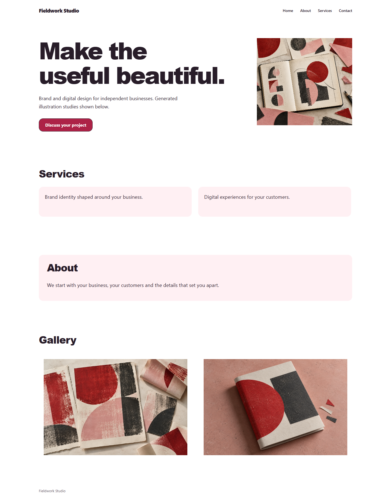
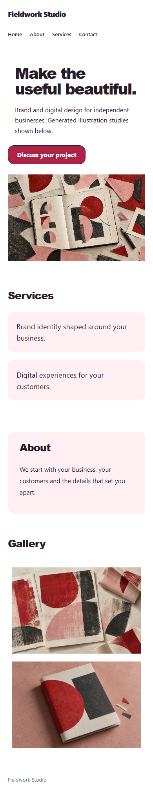

# Website imagery review — 2026-10-22

The text-led limitation was an incomplete asset connection. The service now prepares existing owned
Vault rasters and carries real images through agent tools, immutable versions, private review and
current-published-only serving. Customers provide business information and any actual brand/product
material; the agent selects images and their placement without asking them to assemble a website.

The renderer supports logos, hero imagery, galleries, alternative text, cover/contain crop, aspect
and focal points. It preserves the three business-directed styles. Missing visual material does
not become an invented photograph, testimonial or claim. Existing generated illustrations can be
selected; this preparation tool does not start a paid image-generation job.

## Actual visual review

The fictional Fieldwork Studio fixture uses three generated printmaking studies. The page visibly
identifies them as generated illustrations; they are not client work. Originals, prompt set and
SHA256 hashes are saved in `apps/web/e2e/fixtures/online-presence/README.md`. The built-in image tool
created them; they are test assets, not a default gallery copied into customer websites.

All23 browser checks passed, including nine image-backed views at1440/768/390. A final nine-view
capture additionally awaited actual image decoding and paint, avoiding a screenshot race that
initially left a decoded-size-but-unpainted second image blank. No renderer change was needed.

The review confirms useful dominant imagery, loaded galleries, readable phone layout, real alt text,
correct crop and usable next action. The finite layouts and sparse supplied inner-page copy still
limit bespoke visual character. This is an adapted Taste/UI UX review, not the original upstream
inspector or its full four-image/motion-floor certification.

Other saved directions are in the same folder. A real customer's source material and business
context determine which images and direction the agent chooses; the test forces all three styles
on the same fictional brief to compare their rendering.

## Qualification boundary

The actual specialist runner was exercised with a scripted model through context → image preparation
→ brief → real private build, including preparation retries. Public native tests returned the exact
3.3MiB copied image and rejected storage/hash/size/publication changes. These checks establish the
local integration. They do not establish live model quality, deployed registry activation, merchant
payments or a published customer site.53-02 still needs its designated isolated staging target and
real authenticated/model/public lifecycle observations;53-03 commerce remains partial.
