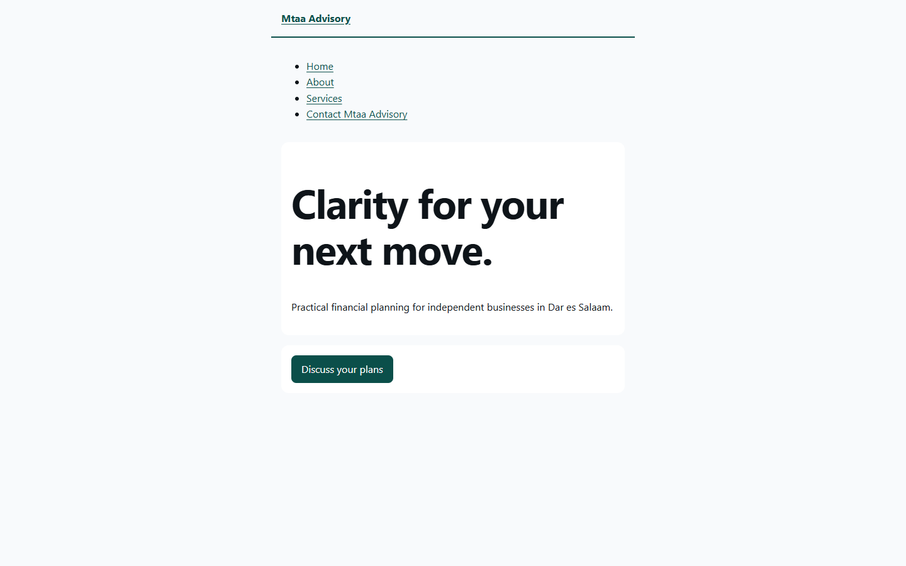
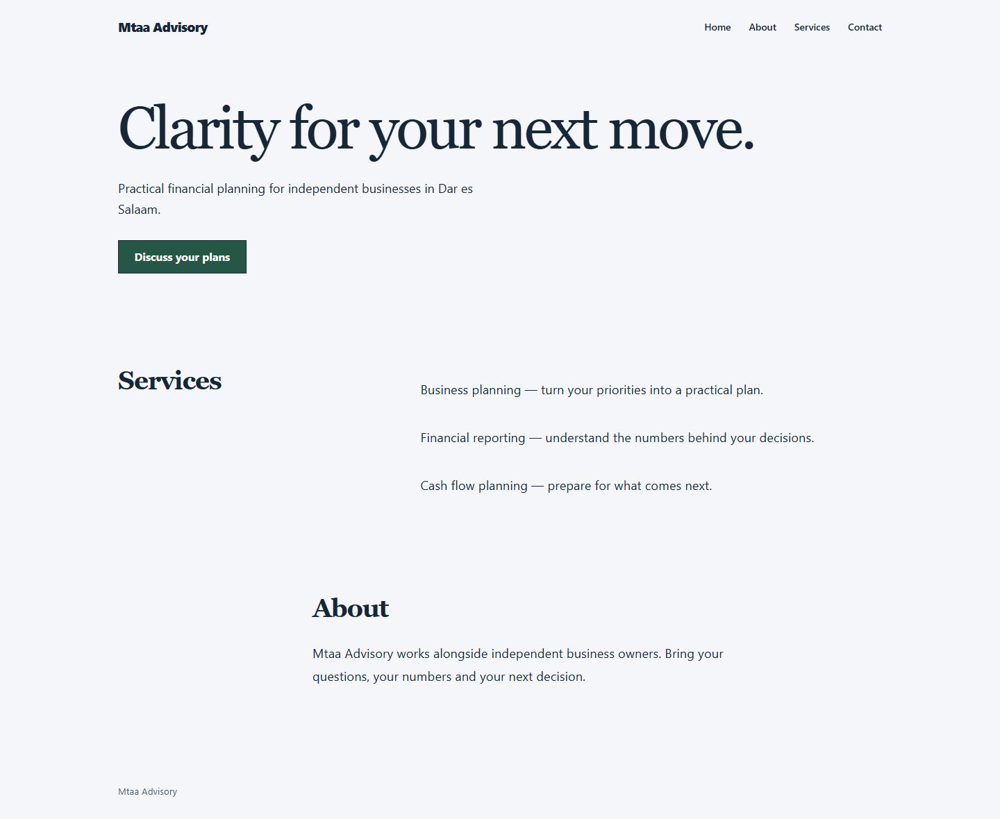

# Online-presence design quality

This is the design contract for generated customer websites. The application shell keeps BRAND.md.
Customer websites use their business identity and saved source-backed brand facts.

## Complementary skill sources

- [Taste Skill, reviewed immutable source](https://github.com/Leonxlnx/taste-skill/tree/6010f91a9935f1c167dfc500fb1a475681892e6b/skills/taste-skill): subject-specific composition, clear hierarchy, sufficient business substance and screenshot critique. Skill blob `433d92105c76671250013e0312d82cb413f552bc`; critique blob `1989a85c83232e86aec66baf733a843947392b37`.
- [UI/UX Pro Max, reviewed repository revision](https://github.com/nextlevelbuilder/ui-ux-pro-max-skill/tree/3eccfd8d77488577f684235a14197b8e6eed3a96): business-fitting design systems, typography/palette guidance and accessibility checks. The current skill's actual location and installation are recorded in the53-04 summary.

Earlier MIT-licensed snapshots remain pinned in `third_party/design-knowledge/manifest.json`.
They already existed before this quality pass; merely including them did not make the previous
output bespoke. The compiled eight-record bundle is unchanged. The finite composition/styles in
this change are Pikar-owned code informed by the reviewed guidance, not arbitrary upstream code,
instructions, a generated-style service, or a claim that all upstream recommendation data is executed.

## Art direction and business evidence

The agent chooses a direction while preparing the brief, using actual business type, audience,
offer and requested tone. Customers need not learn design terminology or operate these controls.

| Direction | Intended fit | Actual presentation difference |
| --- | --- | --- |
| `editorial` | Advisory and other considered professional services | Serif display type, open hierarchy, typographic service index and restrained fields |
| `studio` | Creative businesses and expressive brand work | Strong sans display, asymmetric hero and useful service rail, flat supporting tones |
| `technical` | Operational/technical services | High-contrast hero, precise sans type and compact service structure |

These are bounded starting points, not universal sector stereotypes or award-level custom art
direction. Explicit customer preferences can choose another direction. Optional `primaryColor`
must be a six-digit hex token actually present in a selected trusted source. Save and build both
recheck it. A chosen creative direction is presentation, not proof of an existing brand fact.
No CSS, arbitrary HTML, font/image URL, legal consent, business proof or publication flag is accepted.

Security/privacy and legal boundaries take precedence, then accessibility/semantics, actual tenant
brand facts, then aesthetic recommendations. Preserve an unusual real brand colour; choose readable
control text and link/focus contrast instead of replacing that identity. Higher density means tighter
spacing. Width/spacing/motion dials must affect actual CSS consumers, not decorative tokens.

## Composition and content

Use one clear page title and one real next action. Place the main action with the hero even when
source-backed proof sits between them in the document order. Navigation belongs with the brand,
and targets remain the actual saved project routes. Home carries useful supplied summary, services
and about material. Extra pages exist only when there is real content or a real contact action/form.
Never fill a missing page with a fabricated testimonial, price, number, photograph or integration.

The current output is intentionally text-led. It does not pretend that blank media references are
delivered images. A later owned/licensed asset pipeline needs actual image bytes, tenant checks,
appropriate rights/credits, alt text, reliable serving and erasure. Taste's image and motion floors
are not met by this renderer; do not claim a complete upstream inspector pass or a premium visual
ceiling while those capabilities are absent. CSS feedback preserves reduced-motion access.

## Review method

Compare the same fictional briefs before and after at1440,768,390. Inspect the whole page, including
inner pages: focal hierarchy, shared frame, section rhythm, readable copy, useful next action,
phone composition and what remains generic. Record subjective design, usability, creativity and
content judgments separately from executable checks. They are not benchmark results.

`apps/web/playwright.design.config.ts` runs the independent browser suite in memory, without a
backend, authentication, registry changes or model requests. It covers overflow, actual text line
boxes, headings, tap targets, action placement, correct route/form identity, consent defaults,
keyboard focus, light-brand contrast and multilingual copy. A heading stretched by CSS grid is not
a multiline heading: count text ranges rather than the element box. The suite aborts unexpected
network requests. No generated customer code is executed.

Passing these checks establishes representative renderer usability, not business claim accuracy,
actual model copy quality, per-customer browser qualification or release admission. Exact-source
recipe deterministic and browser gates remain separate. Current fixtures are fictional examples;
they are not customer endorsements, published sites or live acceptance evidence.

## Reviewed output — 2026-10-21

The review used four fictional briefs: an advisory firm, a creative studio, a technical service
and a workshop landing page. The immutable baseline is `bdfad213`. All thirteen final pages were
inspected in overview sheets at1440,768,390; representative full screenshots and the39-view
measurements are saved in [the review folder](online-presence-quality/). The separate14-test
browser suite exercises equivalent fictional scenarios and adversarial contrast/long-text cases.

| Aspect | Review judgment |
| --- | --- |
| Design | Clearer focal hierarchy, consistent frame and genuinely distinct compositions. Still a limited system-font, text-led design family. |
| Usability | Navigation and primary action are visible, mobile layout reflows, and forms retain actual routes and unchecked consent. Automated checks cover representative fixtures, not a complete accessibility audit. |
| Creativity | Editorial, studio and technical choices now change composition as well as colour. Three finite directions are a starting point; imagery, distinctive brand assets and individual concepts remain absent. |
| Content | Supplied services/about material now appears on home, and absent content no longer produces empty pages. Short inner pages remain sparse and may repeat their section title. These scripted briefs do not establish real-model copy quality. |

Overall: a more coherent, usable baseline for private review. The output is not yet a bespoke,
asset-rich website package. The next quality ceiling is actual owned/licensed brand assets and
richer source material, followed by real customer/model and hosted qualification.

Same fictional advisory brief, desktop before and after:

Other final directions and phone screenshots are saved beside these images. No fixture is a
customer endorsement or a published site. Taste's complete image/motion floors and upstream
inspector were not run or met; this is an adapted internal visual review.
